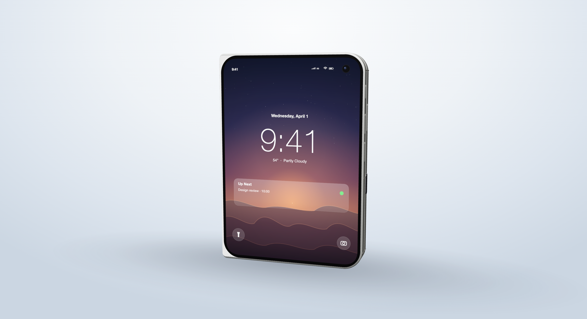

# iPhone Duo — 折叠屏概念建模

用 Three.js 参数化建模的一台**书本式折叠 iPhone** 概念机（"iPhone Duo"）。纯前端、无需构建步骤，
真实尺寸以毫米为单位（1 场景单位 = 1 mm），首屏即可交互折叠、旋转、切换配色并导出 GLB。



## 尺寸规格

| 状态 | 宽 × 高 × 厚 (mm) | 说明 |
| --- | --- | --- |
| 展开 | **164.6 × 117.8 × 5.2** | 7.6" 内屏，近似 iPad mini 比例 |
| 折叠 | **82.4 × 117.8 × 11.3** | 5.4" 外屏 + 1.8 mm 铰链脊 |
| 内屏 | 157.7 × 110.9（1878 × 2670，430 ppi） | 单块连续面板，中间为折痕 |
| 外屏 | 77.2 × 112.3（1398 × 2034，460 ppi） | 挖孔前摄 |
| 铰链 | 0.9 mm 缝隙，转轴在玻璃前 3.05 mm | 单轴折叠，0°–180° |

> 注：Apple 从未发布该机型，`SPEC.closed.w` 里保留了流传的 84.1 mm 说法，但实际建模宽度为
> **82.4 mm**（82.3 mm 半幅 + 0.9 mm 脊），UI 芯片与实测值已对齐到 82.4。

## 运行

```bash
cd iphone-duo
python3 -m http.server 8791        # 任意静态服务器均可
open http://127.0.0.1:8791/index.html
```

需要支持 WebGL2 的浏览器；左上角为折叠滑块（0° = 合盖，180° = 展开），按钮可切换配色、
显示尺寸标注、自动旋转、导出 GLB。

## 截图 / 自动化

`tools/shoot.py`（Playwright）可直接出图，并打印实测包围盒尺寸：

```bash
../.venv/bin/python tools/shoot.py \
  --out renders/final_hero.png --fold 0 --view hero \
  --clean --size 1600x1000 --dpr 2 --wait 1500
```

参数：`--fold 0..180`、`--view hero|front|back|custom`、`--cam x,y,z`、`--finish starwhite|silver`、
`--dims`、`--spin`、`--clean`（隐藏全部 UI）、`--json`（只输出尺寸 JSON）。

页面暴露的脚本接口：

```js
window.__duoReady                 // 首帧渲染完成
window.__duo.setFold(deg)         // 0 合盖 … 180 展开
window.__duo.animateFold(deg)     // 带缓动
window.__duo.setView('hero'|'front'|'back')
window.__duo.setFinish('starwhite'|'silver')
window.__duo.setDims(true)        // 三轴标注
window.__duo.getDims()            // {w,h,d,wAll,dAll}
window.__duo.scene(); window.__duo.camera(); window.__duo.controls()
```

## 文件结构

```
index.html          页面 UI、import map、尺寸芯片
src/model.js        参数化几何体（SPEC + build*，单位 mm）
src/screens.js      Canvas 程序化贴图：锁屏、主屏、外屏、Apple 标志
src/main.js         渲染器、灯光、环境光探针、标注、交互、__duo API
tools/shoot.py      Playwright 截图 CLI
vendor/             three.module.js + addons（无 node_modules）
ref/                设计参考图
renders/            成品图（final_*.png）；过程图在 renders/_wip/
.bak/               model.js 修改前备份
```

## 建模要点

- **面板轮廓**：`panelShape(sign)` 是半个圆角矩形——外侧 r 10.6、上下 117.8，内侧（铰链侧）
  带 **2 mm 圆角**，因此合盖后脊两侧不会出现直角突起；`frontAreaShape()` 是 1.05 mm 钛
  边框内的玻璃轮廓，同样保留 2 mm 铰链圆角。
- **屏幕不溢出边框**：内外屏都用 `ShapeGeometry` 建圆角面板（内屏半片 r 6、外屏 r 7），
  并把 UV 重新归一化到 0–1，保持原来的贴图 `repeat/offset` 半幅切割不变。
- **铰链脊**：`HingeCover` 是 96 mm 长的挤出体，合盖时向内偏移 `COVER_HW × (1 - t)`，
  外表面与机身齐平、不越过圆角。
- **相机**：34 × 22 的圆角平台 + 两颗 φ11.2 镜头（Torus 环 + 玻璃 + 内圈），闪光灯、麦克风孔。
- **材质**：`MeshPhysicalMaterial`（钛金属 `metalness .9 / roughness .44`、玻璃 `transmission`、
  陶瓷背板），环境贴图由 `RoomEnvironment` 经 `PMREMGenerator` 生成，ACES Filmic + 1.02 曝光。
- **接触阴影**：程序化椭圆贴图（边缘衰减到 0）+ `ShadowMaterial` 地面，避免出现矩形阴影边界。

## 已知取舍

- 折叠是**单轴刚体旋转**，没有双轴水滴铰链的多段运动学；0°/180° 两端精确对齐，中间角度
  仅作视觉示意。
- 折痕是一条 0.9 mm 的缝隙（对应真实产品的可见折痕），没有做亚像素级屏幕形变。
- 屏幕内容为 Canvas 程序化绘制，不包含任何 Apple 素材或字体文件（使用系统字体栈）。
- 该机型为**虚构概念**，不存在的产品规格（如 84.1 mm 折叠宽度）仅作参考保留在 `SPEC` 中。

## 声明 / Disclaimer

非官方概念项目，与 Apple Inc. 无任何关联，未获其授权或认可。"iPhone"、"Apple" 商标及 Apple
标志归 Apple Inc. 所有，此处仅用于技术演示与兼容性说明。所有几何体、材质与屏幕内容均为代码
程序化生成；`ref/` 目录下的产品图仅用于本地对比，未纳入版本控制。代码以 MIT 许可释出。
